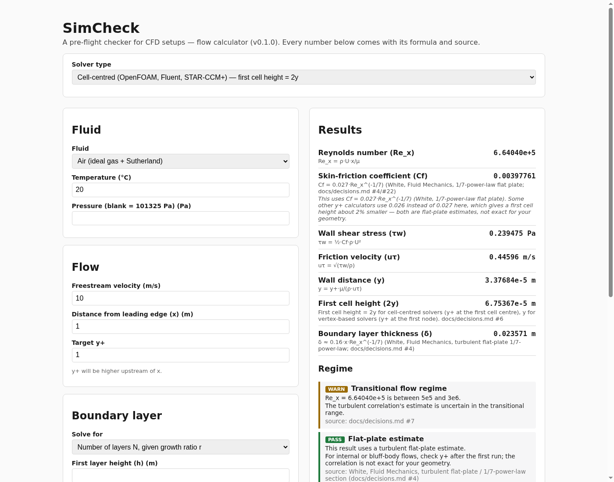

# SimCheck

A free, open-source, browser-based pre-flight checker for CFD setups. No server, no upload, no install — everything runs client-side.

**v0.1 (this release): flow setup calculator.** Pick a solver type and fluid, enter your flow conditions, and get the first-cell wall distance for a target y+, boundary-layer thickness and layer count, a CFL-limited time step, and flow-regime warnings — every number shown with its formula and source.



**v0.2 (in progress): mesh checker** for pure-tet 3D Gmsh meshes, verified against OpenFOAM's `checkMesh`. See [`docs/PLAN.md`](docs/PLAN.md).

What's verified so far: min/max/mean of volume, aspect ratio, non-orthogonality and skewness match OpenFOAM v2512 checkMesh to 1e-6 relative on the test meshes (see [`docs/thresholds.md`](docs/thresholds.md)). The browser UI, worker, and per-mesh findings are not built yet.

## Why

Most y+ calculators stop at a single number. SimCheck:

- picks `y` or `2y` automatically from your solver type (cell-centred like OpenFOAM/Fluent/STAR-CCM+, vertex-based like SU2)
- gives boundary-layer total thickness, number of layers, and growth ratio — solved whichever way you need (N given r, r given N, or fixed r = 1)
- warns about the flow regime with reasons (laminar, transitional, flat-plate estimate only) instead of silently handing you a number that doesn't apply
- explains every output and cites where its formula comes from

## Who it's for

CFD students and engineers using OpenFOAM, Fluent, or SU2. v0.2 (mesh checker) mainly serves student and teaching meshes to start. FEM users are not a target until FEM metrics exist (not before v0.3).

## Running locally

```
pnpm install
pnpm --filter web dev
```

Requires Node 20+ and [pnpm](https://pnpm.io) (available via `corepack enable`).

## Development

See [`CLAUDE.md`](CLAUDE.md) for the project's working agreement, and [`docs/PLAN.md`](docs/PLAN.md) for the full plan, scope, and formulas. Settled decisions are tracked in [`docs/decisions.md`](docs/decisions.md); golden hand-calculated test values are in [`docs/hand-calcs.md`](docs/hand-calcs.md).

```
pnpm install       # install dependencies
pnpm test          # run the test suite
pnpm -r build      # build all packages
pnpm --filter web dev   # run the web app locally
```

## Feedback

SimCheck is a work in progress and your feedback shapes what gets built next. If something's wrong, confusing, or missing from your y+/boundary-layer workflow, please [open an issue](https://github.com/bhuvaneshsaiboligila/simcheck/issues) — one specific thing you tried and what didn't fit is more useful than general praise.

## Licence

MIT.
